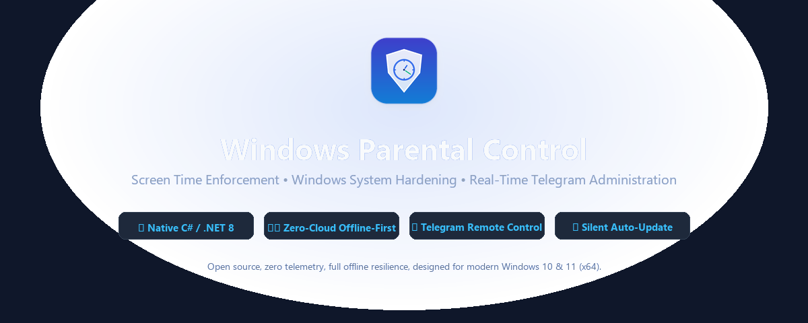
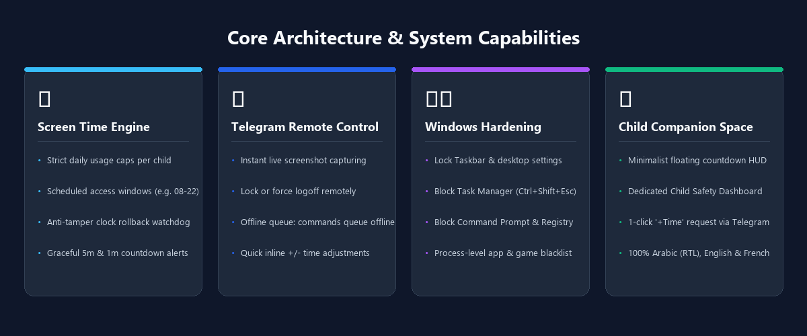
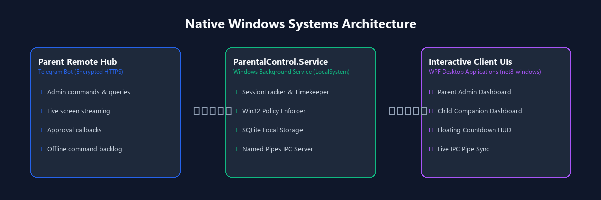

<p align="center">
  
</p>

<h1 align="center">Windows Parental Control</h1>

<p align="center">
  <b>Enterprise-grade screen time management, system hardening, and real-time remote administration for Windows.</b><br>
  Built in native C# and .NET 8. Zero cloud dependencies, offline-first, completely private, and yours.
</p>

<p align="center">
  <a href="https://github.com/XCES4RX/WindowsParentalControl/releases"></a>
  
  
  
  
  
  
  
</p>

<p align="center">
  <a href="https://github.com/XCES4RX/WindowsParentalControl/releases/latest"><b>Download ParentalControlSetup.exe</b></a> •
  <a href="#key-features"><b>Features</b></a> •
  <a href="#telegram-remote-control"><b>Telegram Bot</b></a> •
  <a href="#architecture"><b>Architecture</b></a> •
  <a href="#installation--setup"><b>Setup Guide</b></a>
</p>

---

<p align="center">
  
</p>

---

## Overview

**Windows Parental Control** is a robust, self-hosted parental management solution designed specifically for modern 64-bit Windows environments. Operating as an autonomous background Windows Service running under the `LocalSystem` security context, it enforces strict daily screen time limits, access schedules, system hardening policies, and application blacklists—even if the computer is completely disconnected from the Internet.

Parents can monitor and configure their children's devices in real time from anywhere in the world using their personal **Telegram Bot**, receiving live desktop screenshots, session login/logout alerts, and approving or denying extra time requests with one tap.

---

<p align="center">
  
</p>

---

## Key Features

### 1. Accurate Screen Time & Access Windows
- **Per-Minute Precision:** Tracks active session time on a continuous 1-minute heartbeat, storing usage in a local SQLite database that automatically resets daily at midnight.
- **Allowed Schedule Windows:** Define exact operating hours (e.g. `08:00 - 22:00`). Any login attempts outside this window are automatically rejected.
- **Anti-Tamper Clock Watchdog:** Detects manual system time rollbacks. If a user moves the clock backward to bypass limits, the session is locked immediately for the remainder of the day and a `CLOCK_TAMPER` security event is dispatched to parents.
- **Graceful Warning Alerts:** Child receives visual warnings at **5 minutes** and **1 minute** before session termination to save their work.

### 2. Child Companion Space & Floating HUD
- **Minimalist Floating Countdown:** A translucent, draggable, non-intrusive floating HUD widget displaying remaining session time. Changes color dynamically (Emerald Green &rarr; Amber &rarr; Coral Red).
- **Dedicated Child Safety Dashboard:** Child can click or open the companion dashboard anytime to inspect remaining time, daily usage progress bars, allowed windows, active protection safeguards, and current session duration.
- **One-Click Extra Time Request:** Children can request extra study time (+15m, +30m, +1h) directly through the interface, which instantly pings the parents' Telegram with quick approval buttons. Direct manual time addition by the child is securely blocked.
- **Full Multilingual Localization:** 100% separated native translations for **English**, **Arabic (with native RTL layout)**, and **French**.

### 3. Remote Administration via Telegram Bot
- **Zero Port Forwarding:** Uses long-polling over encrypted HTTPS. Works behind any router, carrier-grade NAT, or firewall without configuring static IPs or VPNs.
- **Offline Command Queue:** Commands sent while the child's PC is powered off or disconnected are held securely in queue and executed automatically the moment the machine boots up.
- **Live Desktop Screenshot (`/screenshot`):** Capture high-resolution desktop captures of the active user session on demand.
- **Remote Lock & Force Logoff:** Instantly lock the workstation or terminate user sessions with a single tap.
- **Comprehensive Event Alerts:** Receive instant alerts for user login, logout, system shutdown, sleep/wake cycles, time limit expirations, app blacklist violations, and clock tampering attempts.

### 4. Windows Hardening & Process Blacklist
- **Task Manager Shield:** Prevents launching Windows Task Manager (`Ctrl+Shift+Esc`) so background processes cannot be killed.
- **Command Prompt & Registry Lock:** Disables `cmd.exe`, PowerShell execution, and `regedit.exe`.
- **System Settings Guard:** Restricts access to Windows Settings and the Control Panel.
- **Process-Level App Blocker:** Continuously scans running processes every 5 seconds. If a blacklisted executable (e.g., games, social media, torrent clients) is detected, it is immediately terminated with tree-kill semantics and parents are notified.

### 5. Silent Background Auto-Updates
- The service periodically checks the official GitHub repository for new stable releases.
- When an update is detected, it silently downloads and applies the installer in the background (`/VERYSILENT`) without interrupting active work.
- Parents receive a confirmation notification in Telegram upon successful update.

### 6. Ultra-Compact & Shared Architecture
- **Deduplicated Runtime:** The Admin UI, Child Companion, and Background Service share a unified .NET 8 runtime footprint, reducing the uncompressed disk footprint from over 410 MB to just ~159 MB.
- **Solid LZMA2 Compression:** Packaged with Inno Setup using 64-bit dictionary solid compression, yielding a setup installer size of **~49 MB** while remaining 100% self-contained (no external .NET installation required).

---

<p align="center">
  
</p>

---

## Telegram Bot Commands

| Command | Action |
|:---|:---|
| `/menu` or `/start` | Displays interactive buttons and primary control panel |
| `/status` | Real-time workstation uptime, service status, active sessions, and remaining time |
| `/screenshot` | Captures and delivers a live desktop screenshot of the current user session |
| `/limits` | Inspects daily usage limits and launches interactive adjustment buttons |
| `/addtime <user> <±min>` | Quickly grants or deducts minutes (e.g. `/addtime PC 30` or `/addtime PC -15`) |
| `/settime <user> <min>` | Sets total daily allowance in minutes (e.g. `/settime PC 180`) |
| `/setschedule <user> <start-end>` | Adjusts allowed window (e.g. `/setschedule PC 08:00-21:30`) |
| `/lock <user>` | Immediately locks the target user workstation |
| `/logout <user>` | Forces immediate logoff of the target user session |
| `/policies` | Reviews active Windows policy restrictions and blacklisted applications |
| `/block <user> <app>` | Adds an executable to the blacklisted app list (e.g. `/block PC roblox`) |
| `/unblock <user> <app>` | Removes an executable from the blacklist |
| `/language` | Switches Telegram bot language (**English**, **العربية**, or **Français**) |
| `/update` | Checks GitHub for updates and triggers an immediate silent upgrade |
| `/events` | Displays the audit log of the last 10 security and session events |

---

## Installation & Setup

### Requirements
- **Operating System:** Windows 10 or Windows 11 (64-bit only).
- **Permissions:** Windows Administrator rights for installation.
- **User Accounts:** Child accounts must be configured as **Standard User** accounts in Windows (Administrator accounts possess privileges to override system restrictions).

### Step-by-Step Setup
1. **Download:** Grab the latest `ParentalControlSetup.exe` from the [Releases](https://github.com/XCES4RX/WindowsParentalControl/releases) page.
2. **Install:** Run `ParentalControlSetup.exe` as Administrator. The installer will register the background Windows Service, configure automatic startup, and install the Admin and Child UIs.
3. **Configure Telegram (Optional but Recommended):**
   - Create a bot on Telegram using [@BotFather](https://t.me/BotFather) and copy your **Bot Token**.
   - Launch **Parental Control** from the Start Menu or Desktop.
   - Navigate to **Settings & Telegram**, enable Telegram Bot integration, paste your token, and save.
   - Send `/start` to your bot in Telegram to authorize your account.
4. **Configure Limits:** Select the standard user account in the Admin dashboard, set daily minute limits and allowed schedules, and toggle desired Windows security restrictions.

---

## Building from Source

### Prerequisites
- [.NET 8.0 SDK](https://dotnet.microsoft.com/download/dotnet/8.0) (v8.0.400 or later)
- [Inno Setup 6.2+](https://jrsoftware.org/isdownload.php) (for building the installer)
- PowerShell 5.1+

### Build Steps
```powershell
# Clone the repository
git clone https://github.com/XCES4RX/WindowsParentalControl.git
cd WindowsParentalControl

# Execute automated build & packaging script
powershell -ExecutionPolicy Bypass -File .\build.ps1
```
The compiled, compressed installer will be generated at `installer\Output\ParentalControlSetup.exe`.

---

## Privacy & Security

- **Zero Third-Party Cloud Services:** No data is sent to external servers or telemetry platforms.
- **Local SQLite Database:** All configuration parameters, daily usage metrics, and audit logs are stored locally on the machine at `C:\ProgramData\ParentalControl\parentalcontrol.db`.
- **Encrypted Communication:** Telegram interactions communicate directly with the official Telegram API over TLS 1.3.
- **Privilege Separation:** Management UI communicates with the core service via authenticated Local Named Pipes.

---

## License

This project is licensed under the [MIT License](LICENSE). You are free to inspect, modify, and distribute the code in accordance with the license conditions.
