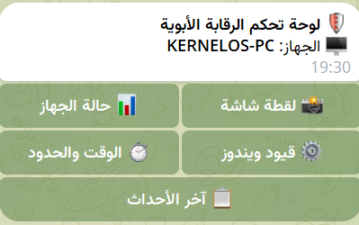
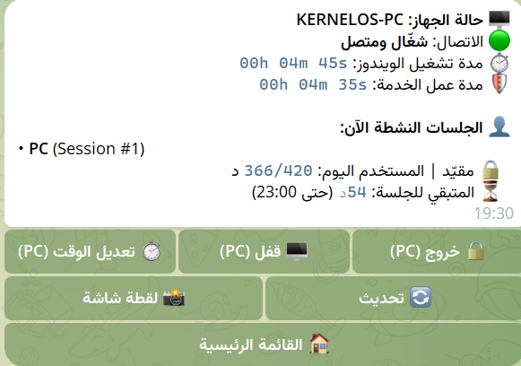
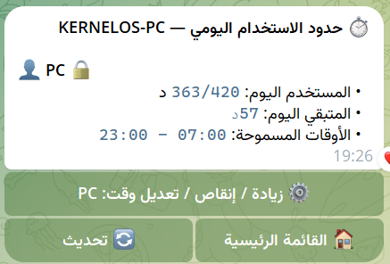
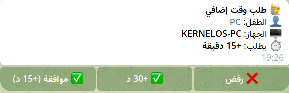
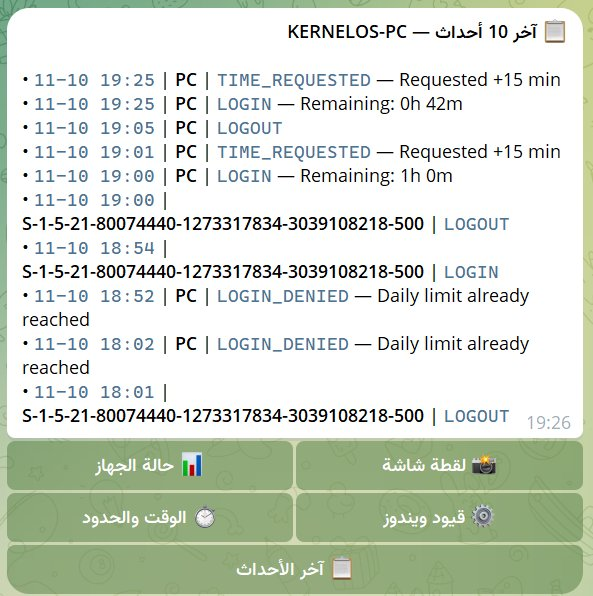

# نظام الرقابة الأبوية لويندوز — Windows Parental Control

> **مبني ومطوّر على مشروع [robertpin/WindowsParentalControl](https://github.com/robertpin/WindowsParentalControl) (برخصة MIT)** مع إضافات متقدمة تشمل التحكم الكامل عبر بوت تلغرام، أخذ لقطات شاشة مباشرة، قيود ويندوز لكل طفل، حظر التطبيقات والألعاب، ومربع عدّ تنازلي عائم على شاشة الطفل.

---

## التحميل والتثبيت السريع

1. حمّل أحدث ملف تثبيت `ParentalControlSetup.exe` من صفحة **[الإصدارات (Releases)](https://github.com/XCES4RX/WindowsParentalControl/releases)**.
2. شغّل المثبّت كمسؤول (**Run as Administrator**) واتبع خطوات التثبيت.
3. تأكد من أن حساب الطفل على ويندوز هو حساب قياسي (**Standard User**) وليس Administrator، لأن حسابات المسؤولين لا تخضع للتقييد.

---

## لقطات من بوت تلغرام والنظام

| القائمة الرئيسية للبوت | حالة الجهاز والجلسة النشطة |
|---|---|
|  |  |

| حدود الاستخدام وتعديل الوقت | طلب وقت إضافي من الطفل (موافقة / رفض) |
|---|---|
|  |  |

### سجل الأحداث الفوري عبر تلغرام


---

## المميزات الرئيسية

### 1. إدارة الوقت والجدول الزمني
- **حد يومي للاستخدام:** تحديد عدد الدقائق المسموحة يومياً لكل حساب قياسي (تُحسب دقيقة بدقيقة وتُصفَّر تلقائياً عند منتصف الليل).
- **نوافذ زمنية (Schedule):** تحديد ساعات العمل المسموحة (مثلاً `07:00 - 23:00`) ومنع تسجيل الدخول خارجها.
- **تنبيه قبل انتهاء الوقت:** إظهار نافذة تحذيرية على شاشة الطفل قبل **5 دقائق** وقبل **دقيقة واحدة** من انتهاء الجلسة لحفظ أعماله.
- **كشف التلاعب بالساعة:** إذا تم إرجاع ساعة النظام للخلف، يغلق النظام الجلسة فوراً لبقية اليوم ويسجل حدث `CLOCK_TAMPER`.

### 2. مربع العدّ التنازلي العائم للطفل (`ParentalControl.Overlay`)
- مربع صغير أنيق وشفاف يطفو في زاوية الشاشة (قابل للسحب) ويعرض الوقت المتبقي الفعلي لنهاية الجلسة (الأقل بين المتبقي اليومي ونهاية الجدول).
- يتغير لونه تلقائياً حسب الوقت المتبقي (أخضر ← برتقالي عند ≤ 15 دقيقة ← أحمر عند ≤ 5 دقائق).
- يحتوي على زر **`+15m`** ليرسل الطفل طلباً فورياً للوالدين عبر تلغرام للموافقة أو الرفض بضغطة زر.

### 3. قيود ويندوز لكل طفل (Windows Restrictions)
يمكن تفعيل كل قيد بشكل مستقل لكل حساب طفل من لوحة الإدارة وتُطبَّق تلقائياً عبر `HKEY_USERS\{SID}`:
- **قفل شريط المهام (`LockTaskbar`):** قفل شريط المهام ومنع إعداداته وقائمة الزر الأيمن.
- **منع الإعدادات ولوحة التحكم (`NoControlPanel`):** حظر **Windows Settings** و**Control Panel**.
- **منع مدير المهام (`DisableTaskMgr`):** تعطيل **Task Manager** (`Ctrl+Shift+Esc`).
- **منع موجه الأوامر (`DisableCMD`):** تعطيل **Command Prompt (`cmd.exe`)**.

### 4. حظر التطبيقات والألعاب (App Blocker)
- تحديد أسماء العمليات المحظورة لكل طفل (مثل `robloxplayerbeta`، `discord`، `steam`).
- تراقب الخدمة العمليات كل 5 ثوانٍ وتغلق أي تطبيق محظور في جلسة الطفل تلقائياً مع تسجيل حدث `APP_BLOCKED` وإرسال تنبيه فوري إلى تلغرام.

### 5. التحكم والمراقبة عن بُعد عبر بوت تلغرام
- ربط سهل من صفحة **Settings & Telegram** بلصق **Bot Token** أو **رابط الـ API كاملاً** (`https://api.telegram.org/bot...`).
- إشعارات تلقائية عند تسجيل الدخول، انتهاء الوقت، تشغيل تطبيق محظور، محاولات التلاعب بالساعة، وتقرير يومي تلقائي بعد الساعة `21:00`.

#### أوامر بوت تلغرام المتاحة
| الأمر / الزر | الوظيفة |
|---|---|
| `/start` أو `/menu` | عرض القائمة الرئيسية التفاعلية |
| `/status` | حالة الجهاز، مدة التشغيل، الجلسات النشطة، والوقت المتبقي مع أزرار قفل الشاشة والخروج وتعديل الوقت |
| `/screenshot` | التقاط لقطة شاشة حية من جلسة المستخدم النشطة وإرسالها فوراً |
| `/limits` | عرض حدود الاستخدام اليومي وفتح قائمة زيادة/إنقاص/تعديل الوقت لكل مستخدم |
| `/addtime <user> <±min>` | زيادة أو إنقاص الحد اليومي مباشرة (مثال: `/addtime PC 30` أو `/addtime PC -15`) |
| `/settime <user> <min>` | تعيين الحد اليومي بالدقائق (مثال: `/settime PC 120`) |
| `/setschedule <user> <HH:mm-HH:mm>` | تعديل الجدول المسموح (مثال: `/setschedule PC 08:00-21:30`) |
| `/policies` | عرض قيود ويندوز والبرامج المحظورة لكل حساب |
| `/block <user> <app>` / `/unblock <user> <app>` | حظر أو فك حظر تطبيق معين عن بُعد |
| `/events` | عرض آخر 10 أحداث مسجلة |

---

## طريقة ربط بوت تلغرام خطوة بخطوة

1. أنشئ بوتاً جديداً عبر [@BotFather](https://t.me/BotFather) على تلغرام واحصل على **Bot Token**.
2. افتح برنامج **Parental Control** على الحاسوب واضغط **Settings & Telegram**.
3. فعّل **Enable Telegram Bot integration** والصق التوكن (أو رابط الـ API كاملاً) في خانة **Telegram Bot Token or API URL**.
4. اضغط **Test & Connect Bot**.
5. افتح محادثة البوت في تلغرام واضغط **Start (`/start`)**، ثم اضغط **Detect Chat ID** داخل البرنامج ليتم الربط تلقائياً.

---

## البنية البرمجية (Architecture)

```text
+---------------------------+       +---------------------------+
|   ParentalControl.Admin   |       |  ParentalControl.Service  |
|   (WPF Admin Dashboard)   |       |  (LocalSystem Service)    |
|  - Dashboard & UserDetail |       |  - SessionTracker         |
|  - Windows Restrictions   |       |  - UsageMonitorWorker     |
|  - Blocked Apps UI        |       |  - OverlayHostWorker      |
|  - Settings & Telegram    |       |  - TelegramBotWorker      |
+-------------+-------------+       +-------------+-------------+
              |                                   |
              +---------> ParentalControl.Core <--+
                            |        |
                   SQLite Database   Named Pipe IPC
        (C:\ProgramData\ParentalControl)  |
                                          v
                           +-----------------------------+
                           |  ParentalControl.Overlay    |
                           |  (User Session Countdown &  |
                           |   Desktop Screenshot Helper)|
                           +-----------------------------+
```

---

## البناء من المصدر (Build from Source)

يتطلب **.NET 8 SDK** و**Inno Setup 6**:

```powershell
.\build.ps1
```

ينتج المثبّت الكامل في: `installer\Output\ParentalControlSetup.exe`.

---

## English Overview

**Windows Parental Control** is an open-source Windows utility (built on [robertpin/WindowsParentalControl](https://github.com/robertpin/WindowsParentalControl)) with per-user daily limits & schedules, Windows policy restrictions (`LockTaskbar`, `NoControlPanel`, `DisableTaskMgr`, `DisableCMD`), per-user process blocking, a floating child countdown overlay (`+15m` extra time requests), live desktop screenshots, and full remote management via Telegram Bot.

## License

MIT License — see [LICENSE](LICENSE).
